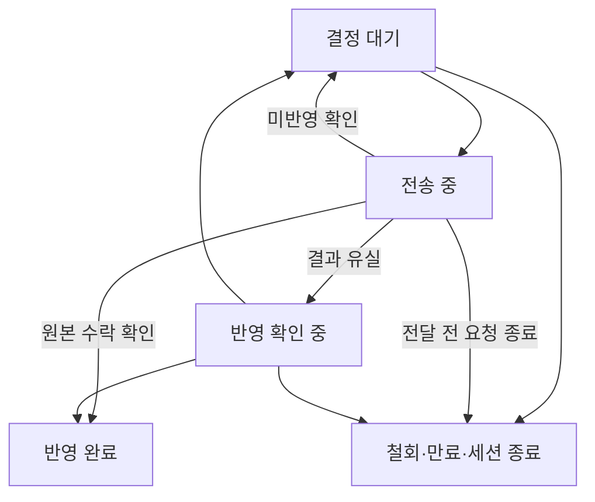

# AI 작업 상태·결정 대기 알림 설계

상태: **설계 v0.6 · 0~2단계 완료(상시 알림 앱, 실제 데이터 수집, Claude Code 질문·권한에 폰으로 답하기, 지시 대기 표시) · 4단계 일부(기록 정리·등록 시도 제한)** · 원본: 「맥미니 AI 작업 상태·결정 대기 알림 개발 명세」 초안 v0.1(2026-11-24, 비공개)

## 현재 구성 요약(2026-11-26)

이 문서는 단계마다 결정을 덧붙여 왔다. 아래가 지금 동작하는 구성이고, 뒤의 PWA·Web Push 서술은 기록으로 남긴다.

| 부분 | 지금 |
|---|---|
| 폰 | 네이티브 Android 앱(`android/`, 외부 라이브러리 없음). 소리 없는 상시 알림 하나: `진행 N · 결정 대기 M · 지시 대기 K`와 구독 사용량. 누르면 대시보드, 답할 결정이 하나면 바로 답변 화면. 푸시는 쓰지 않는다(Web Push 구독·발송 대기열 코드와 테이블은 2026-11-26 삭제, 스키마 v4. 0단계 검증 기록은 `spikes/webpush/`에 남김) |
| 연결 | 서버 실시간 스트림(SSE) 하나. Tailscale Serve HTTPS(tailnet 전용) → 맥 `127.0.0.1:8770`. 앱 토큰은 Android Keystore로 암호화 |
| 맥 서버 | `notifier serve`(LaunchAgent로 상시 실행). SQLite 하나에 세션·결정·답·사용량 |
| Claude Code | 전역 훅으로 세션 상태 관측. `PermissionRequest` 훅이 질문·실행 권한을 폰 결정으로 올리고 맥 창과 동시에 기다려 먼저 온 답을 쓴다(6장 2c) |
| Codex | 기록 파일(`~/.codex/sessions`)을 읽어 세션 상태·사용량 관측만 |
| 사용량 | Claude는 `claude -p /usage`(모델 호출 없음) 5분마다, Codex는 기록 파일의 `rate_limits` |
| 세션 상태 | 진행 중 · 결정 대기 · 입력 대기(맥에서 확인) · **지시 대기**(턴을 마치고 다음 지시를 기다림) · 유휴 · 완료·중단·실패 |
| 기록 보관 | 끝난 결정(질문·실행 내용·답)은 하루, 끝난 세션은 일주일 뒤 삭제. 프롬프트·대화 내용은 저장하지 않는다 |

## 0. 이 문서가 원본과 다른 점

### 2026-11-25 방향 전환: 푸시 대신 상시 알림(Android 앱)

사용자 결정: **변화마다(또는 결정마다) 푸시를 받는 대신, 폰 알림창에 상태 창 하나가 계속 떠 있게 한다.** 결정 요청도 푸시하지 않고, 상시 알림의 숫자로만 보이며 누르면 답변 화면으로 들어간다.

| 항목 | 내용 |
|---|---|
| 폰 앱 | **네이티브 Android 앱**(Kotlin, 외부 라이브러리 없음, `android/`). PWA로는 상시(ongoing) 알림을 만들 수 없어서 아래 PWA 결정을 되돌린다 |
| 상시 알림 | 포그라운드 서비스(specialUse)가 소리·진동 없는 알림 하나를 계속 고친다. 제목 `진행 N · 결정 대기 M`, 본문 `Claude 5시간 48% · 주간 4%  \|  ChatGPT …`, 펼치면 결정·세션 목록. 상태바 아이콘은 결정 대기가 있으면 채운 원 안의 숫자, 없으면 진행 수 |
| 갱신 | 서버 실시간 스트림 `GET /v1/stream`(SSE) 하나를 유지. 버전이 바뀌면 즉시, 아니어도 30초마다 스냅샷. 끊기면 2초→60초 백오프, 네트워크 복귀 시 즉시 재연결. 끊긴 동안은 마지막 값과 '○○ 기준'을 표시 |
| 누르면 | 답할 결정이 하나면 바로 답변 화면, 아니면 대시보드(결정·사용량·세션) |
| 사용량 | 제공자별 구독 사용량(창 단위 %)을 `UsageReported` 이벤트로 받아 스냅샷에 싣는다. Claude는 공식 CLI의 `rate_limit_event`(five_hour·seven_day 사용률)에서, Codex는 설치 후 공식 경로를 검증해 붙인다 |
| 인증 | 앱은 등록 때 토큰을 본문으로 받아(`token_in_body`, Origin 없는 요청만) Android Keystore로 암호화해 저장하고 `Authorization: Bearer`로 보낸다 |
| 푸시 | 쓰지 않는다. Web Push 구독·발송 대기열 코드는 남아 있지만 앱은 사용하지 않는다 |
| 전력 | 화면이 꺼져도 연결을 유지하려면 배터리 최적화 해제가 필요(앱에서 안내) |

아래 2026-11-24 PWA 결정과 F03·F05·F10·F11 서술은 이 전환으로 대체된다.

2026-11-24 사용자 결정: **갤럭시 네이티브 앱(Kotlin) 대신 PWA + Web Push로 MVP를 만든다.**

| 원본 | 이 문서 | 이유 |
|---|---|---|
| Kotlin·Compose 갤럭시 앱 | **독립 서비스**(이 저장소)가 PWA 화면을 직접 제공하고 manifest·service worker로 설치형으로 만든다 | 이 Mac에 Android SDK·adb가 없음. Tailscale Serve HTTPS(`https://<맥 이름>.<tailnet>.ts.net`)로 접속 |
| Firebase Cloud Messaging | **Web Push(VAPID, RFC 8030/8291/8292)**를 맥이 직접 발송 | Firebase 계정·`google-services.json` 불필요. 페이로드는 종단 간 암호화 |
| 알림창 상시 요약 카드(F03) | 요약은 **대시보드**가 기본. 요약 알림은 선택 기능(기본 끔) | 웹 알림은 상시(ongoing) 알림이 될 수 없고, Chrome은 푸시마다 알림 표시를 강제(userVisibleOnly)해 조용한 동기화가 안 됨 |
| 알림 채널 2개(F10) | 앱 안 설정으로 '요약 알림'·'결정 알림'을 나눔 | Android에서 사이트 알림은 채널 하나로 묶임 |
| F11 상태바 칩·Now Bar, F13 알림에서 답변 | **웹에서 불가 → 네이티브 전환 시 재검토** | Live Updates·인라인 답변은 네이티브 API |
| Claude Code·Codex 동시 MVP | **Claude Code 먼저**, Codex는 설치 후 3단계 | 이 Mac에 Codex CLI 없음 |

서버(맥미니 서비스)의 상태 모델·API·인수 조건은 원본을 유지한다. 나중에 네이티브 앱으로 옮겨도 서버는 그대로 쓴다.

## 1. 목표

맥미니에서 Claude Code(이후 Codex) 세션을 여러 개 실행해 두고, 갤럭시에서 **진행 중 작업 수**와 **내 답이 필요한 결정 요청**을 확인한다. 새 결정에만 배너와 진동이 온다. 알림을 누르면 질문과 선택지가 열리고, 답하면 원래 세션에 반영되어 작업이 이어진다.

- 결정 요청 = 작업 방향을 묻는 프로젝트 질문(예: "중복 발견 시 가져오기 전체 중단 / 해당 행만 건너뛰기"). 명령·파일 접근 같은 **실행 권한 요청**은 제공자 화면에서 처리하고, 이 앱은 세션 상세에 '권한 승인 대기'와 여는 경로만 보여 준다. (2c단계 변경: Claude Code의 실행 권한도 '허용/거부' 결정으로 폰에서 답할 수 있다. 맥 창은 그대로 함께 뜬다.)
- 최상위 세션을 한 건으로 센다. 서브 에이전트는 상위 세션에 포함한다.

## 2. 기능

### 2.1 MVP

| ID | 기능 | 동작과 인수 조건 |
|---|---|---|
| F01 | 기기 연결 | 맥에서 `notifier pair`로 만든 1회용 코드(10자, 10분)를 폰에서 입력해 기기 쿠키(HttpOnly·SameSite=Lax·Secure, 토큰은 해시만 저장)를 받는다. 등록된 기기가 PWA에서 알림을 허용하면 **푸시 구독**(endpoint·p256dh·auth)을 기기에 묶어 저장한다. `notifier revoke`로 해제하면 조회·응답을 거절하고 구독과 보내지 않은 푸시를 지운다. |
| F02 | 세션 상태 수집 | 관리 세션의 시작·진행·입력 대기·완료·중단·실패를 수집한다. 식별자는 (제공자, 원본 세션 ID). 같은 세션의 턴을 여러 건으로 세지 않는다. 관리하지 않는 기존 세션은 검증된 관측 경로(훅)가 있을 때만 보조 모니터링한다. |
| F03 | 진행 요약 | 대시보드 상단에 '진행 3 · 결정 대기 2'. 연동이 정상인 유휴 상태는 '진행 0 · 결정 대기 0'. 선택 기능 '요약 알림'(기본 끔): 숫자가 바뀔 때 고정 tag 알림을 소리·진동 없이 교체한다. |
| F04 | 결정 요청 등록 | 제공자의 명시적 질문이나 구조화된 결정 요청만 접수한다. 원본 세션·요청 ID, 작업명, 질문, 선택지, 자유 입력 허용, 생성 시각, 선택적 마감을 저장한다. 일반 로그·턴 종료·대화 속 물음표·유휴는 상태에만 반영한다. 한 요청에 질문이 여러 개면 한 건으로 보여 주고 한 화면에서 모두 답한다. |
| F05 | 결정 푸시 | 요청이 처음 답변 가능해질 때 요청당 알림 한 건. 알림 문구는 **'AI 작업에 결정이 필요해요'** 같은 공통 문구만(작업명·질문·코드 미포함). 표시·소리는 기기 설정과 방해 금지를 따른다. |
| F06 | 목록·상세·마감 | 진행 중 세션과 열린 결정 목록. 결정은 마감 임박순, 같거나 마감 없는 것은 생성순. 상세에 작업명·제공자·질문·선택지·추천 이유·남은 시간 또는 '마감 없음'. 처리된 요청을 지난 알림으로 열면 결과를 보여 준다. |
| F07 | 원래 요청에 답변 | 선택지 또는 허용된 자유 입력 후 '보내기'. 갤럭시 키보드 음성 입력도 같은 흐름. 답은 해당 요청·원본 세션에 고정. '전송 중', '반영 완료', '재시도 가능한 실패', '반영 확인 중'을 구별한다. |
| F08 | 대기 해제·만료·재질문 | 원본 반영이 확인되면 목록과 알림을 정리한다. 맥에서 먼저 답한 요청도 확인 후 정리. 세션 종료·철회·마감 도달 시 새 응답을 닫고 사유를 표시. 추가 질문은 새 요청. |
| F09 | 연결 복구 | 연결이 끊기면 마지막 확인값과 시각을 '연결 끊김'/'갱신 지연'으로 표시. 앱 열기·새로고침·복구 시 서버 최신 상태로 맞춘다. 중복·지연 이벤트와 오래된 푸시가 화면을 과거로 되돌리지 않는다. |
| F10 | 알림 권한·설정 | 앱 안 설정에서 요약 알림·결정 알림을 따로 켠다. 알림 권한이 없어도 조회·답변 화면은 동작하고 권한 안내를 보여 준다. |

### 2.2 후속

| ID | 기능 | PWA에서 |
|---|---|---|
| F11 | 상태바 칩·Now Bar | 불가. 네이티브 전환 시 |
| F12 | '곧 올 것'(공개 예정 결정) | 가능 |
| F13 | 알림에서 바로 답변 | 불가(Chrome 알림에 텍스트 입력 없음). 선택지 버튼 액션은 검토 가능 |
| F14 | 구독 잔여 사용량 | 공식 경로가 있을 때만 |

### 2.3 상태와 숫자 계산

- **진행 수**: 작업 중인 최상위 세션 수. 창만 열려 있거나 다음 지시를 기다리는 세션은 유휴. 프로젝트 답변이나 권한 승인을 기다리며 전부 막힌 세션은 빠진다. 같은 세션에서 독립 작업이 도는 신호가 있으면 포함. 수집 못 한 세션이 있으면 마지막 확인값과 '갱신 지연'을 함께 표시.
- **결정 대기 수**: 처리가 확인되지 않은 열린 결정 요청 수. 한 세션의 서로 다른 요청 두 건은 두 건. 답을 보냈어도 반영 확인 전에는 남긴다. 반영 여부를 모르면 자동 재전송하지 않고 원본 상태를 조회한다.

| 요청 상태 | 대기 수 | 입력 | 진입 조건 |
|---|---|---|---|
| 공개 예정 | 아니요 | 아니요 | 후속(F12). 공개 시각 전 |
| 대기 | 예 | 예 | 최초 공개, 또는 미반영이 확인된 전송 실패 |
| 전송 중 | 예 | 아니요 | 서버가 답을 접수하고 입력권을 잠금 |
| 반영 확인 중 | 예 | 아니요 | 연결 단절·응답 유실로 반영 여부 불명 |
| 반영 완료 | 아니요 | 아니요 | 원본 수락 또는 다른 화면의 처리 완료 확인 |
| 철회·만료·세션 종료 | 아니요 | 아니요 | 철회·만료·세션 종료 확인 |

마감은 서버 UTC로 저장하고 폰에서 현지 시각·남은 시간으로 보여 준다. 서버 시각 ≥ 마감이면 새 응답을 받지 않는다. 접수했더라도 원본 전달 전에 마감·철회가 확인되면 전달을 중단한다.

## 3. 인수 테스트

조건 → 행동 → 검증. 도메인 계산·상태 전이는 고정 시계와 가짜 제공자로 자동화하고, 제공자 계약은 실제 CLI로, 알림 표시는 실제 갤럭시(S22 Ultra)에서 확인한다. 원본 T01~T37을 유지하되 PWA 때문에 바뀐 항목만 아래에 적는다(원본 테스트 전문은 이 저장소에 없음).

| ID | PWA 변경 |
|---|---|
| T01·T02 | 독립 서비스의 1회용 코드 등록을 쓴다. T02의 '미전달 푸시 취소'는 '해당 기기 푸시 구독 삭제와 발송 대기열 취소' |
| T07 | 요약 알림을 켰을 때만 해당. 같은 tag 알림 하나가 소리·진동 없이 교체되고 최종 값 1 |
| T26 | 'PWA를 닫고 화면을 끈 상태'에서 모바일 데이터로 결정 발생 → 알림 도착, 누르면 잠금 해제 후 원래 상세 |
| T27 | 사이트 알림 권한 거부 시 팝업 없음, 앱 안 조회·답변 가능. 앱 안에서 요약만 끈 경우 결정 알림은 도착 |
| T28 | **완화**: 요약 알림을 닫아도 다음 숫자 변화 때 다시 나타날 수 있다(웹 제약). 닫은 뒤 다시 보지 않으려면 앱 안에서 요약 알림을 끈다 |
| T29 | `pushsubscriptionchange` 또는 구독 재발급 후 현재 구독만 사용, 410/404 응답 구독은 삭제, 중복 등록 없음 |
| T30 | 알림 문구·푸시 페이로드에 작업명·코드·답변 없음(페이로드는 이벤트 유형·불투명 요청 ID·스냅샷 버전만) |
| T31 | 1차는 Claude Code만. Codex는 3단계에서 추가 |
| T33·T34·T36 | 네이티브 전환 시까지 보류 |

MVP 완료 조건: T01~T32(위 변경 포함) 통과, T31 실환경 통과, 동시 응답·재전송 테스트에서 잘못된 세션 전달·중복 적용 0건. 측정 목표(원본 2.3절): 맥 이벤트 수신 → 상태 저장·발송 대기열 기록 p95 1초(세션 30개·이벤트 100개), 실제 갤럭시 Wi-Fi·모바일 데이터 각 10회 중 90%가 30초 안에 표시, 마지막 정상 갱신 2분 초과 시 '갱신 지연'.

## 4. 구성

| 구성 | 역할 | 선택 |
|---|---|---|
| 맥미니 서비스 | 세션·결정 상태 계산, 조회·응답 API, 푸시 발송 | **독립 Rust 서비스 `notifier`**(axum·sqlx·SQLite, 이 저장소). 기존 개인 비서와 프로세스·DB·인증을 공유하지 않는다(2026-11-25 결정) |
| 제공자 연동 | 세션 이벤트를 공통 형식으로, 답을 원래 요청에 전달 | 0단계 결과로 결정(5장) |
| 폰 화면 | 대시보드·목록·상세·답변, 알림 클릭 처리 | PWA: manifest, service worker(`push`·`notificationclick`·`pushsubscriptionchange`), `notifier`가 정적 파일로 제공(2단계) |
| 원격 접속 | 밖에서 상세 조회·답변 | Tailscale Serve HTTPS(tailnet only) + 기기 쿠키. 이미 운영 중 |
| 푸시 | 앱을 열지 않아도 새 결정 알림 | Web Push. VAPID 키는 설정 폴더에 600으로 보관. 맥 → 브라우저 푸시 서비스로 나가는 외부 연결이 필요 |

### 데이터와 API(원본 3.3 유지, 푸시 부분만 변경)

- 세션, 결정 요청, 답변 제출, 기기, 이벤트·알림 대기열: 원본 필드 그대로. 기기의 '푸시 토큰'은 **푸시 구독(endpoint·키)**으로 바뀐다.
- `POST /v1/pairing/exchange`: `{code, name}` → 기기 쿠키. 성공한 코드는 다시 쓸 수 없다.
- `GET /v1/snapshot`, `GET /v1/decisions/{id}`, `POST /v1/decisions/{id}/answers`(요청 버전 + 제출 ID, 멱등), `GET /v1/decisions/{id}/answers/{submissionId}`: 원본 그대로.
- `PUT /v1/device/push-token` → `PUT /v1/device/push-subscription`(인증된 현재 기기의 구독 교체), `DELETE` 동일 경로.
- 알림은 요약에 고정 tag, 결정에 요청별 tag를 써서 중복 푸시가 다시 울리지 않게 한다. 푸시 TTL은 마감보다 길지 않게.

## 5. 0단계: 핵심 연동 검증

목표: 폰에서 보낸 답이 원래 Claude Code 세션에 들어가 작업이 이어지는 경로를 확정한다.

| 후보 | 내용 | 확인할 것 |
|---|---|---|
| A. 관리 세션 + 권한 도구 | 서비스가 공식 `claude` CLI를 헤드리스로 띄우고, `AskUserQuestion` 호출을 권한 처리 경로로 가로채 답을 돌려준다 | 질문 구조 수신, 답 주입, 같은 세션 재개, 구독 로그인으로 동작 |
| B. 질문용 MCP 도구 | 우리 MCP 서버의 `ask_user` 도구를 세션에 붙이고, 도구 호출이 폰 답을 받을 때까지 기다린다 | 평소 대화형 세션에서도 동작하는지, 모델이 이 도구를 쓰게 할 수 있는지, 대기 시간 제한 |
| C. 훅 관측 | 평소 세션의 훅(UserPromptSubmit·Stop·Notification·SessionEnd 등)으로 진행·대기 상태만 수집 | 데스크톱 앱 Code 탭 세션에서도 훅이 오는지, 질문·권한 대기를 구별할 수 있는지 |
| D. 공식 Remote Control | Claude 공식 앱에서 세션을 원격으로 이어 받기 | 대체 경로로 쓸 수 있는 범위 |

**원칙**: 구독 로그인 토큰을 꺼내 API를 직접 부르지 않는다. 터미널에 문자열을 흘려 넣는 자동화를 쓰지 않는다. 직접 응답이 검증된 세션만 '보내기'를 켜고, 나머지는 공식 경로 링크를 보여 준다.

### 0단계 결과(2026-11-24, Claude Code 2.1.330)

실행 조건: 빈 임시 폴더, `CLAUDE_CODE_DISABLE_CLAUDE_MDS=1`, `--setting-sources project`, `--strict-mcp-config`, `--tools AskUserQuestion`. 로그인은 전용 설정 폴더 `CLAUDE_CONFIG_DIR=<전용 폴더>`(apiKeySource "none" = 구독). **기본 `~/.claude` 로그인은 만료 상태였다**(`OAuth session expired`).

| 후보 | 결과 | 근거 |
|---|---|---|
| A. 헤드리스 + `--permission-prompt-tool` | **통과** | MCP 도구가 `{tool_name:"AskUserQuestion", input:{questions[]}, tool_use_id}`를 받는다. `{"behavior":"allow","updatedInput":{...input,"answers":{"<질문 전문>":"<라벨>"}}}`를 텍스트로 돌려주면 도구 결과가 `"<질문>"="<라벨>"`로 들어가고 같은 세션에서 이어진다. 즉시 응답 7.4초, **98초 늦은 답도 정상 반영**(전체 103.8초) |
| A의 전제 | 확인 | 헤드리스에서 응답자(`--permission-prompt-tool` 또는 SDK 호스트)가 없으면 **AskUserQuestion이 도구 목록에서 빠진다**. 모델이 호출 흉내를 텍스트로 쓰고 끝남(haiku·sonnet 모두) |
| C. PreToolUse 훅으로 답 주입 | **통과(헤드리스)** | 훅이 `permissionDecision:"allow"` + `updatedInput.answers`를 내면 권한 도구는 불리지 않고 훅 답이 쓰인다. 훅 `timeout:600`에서 **75초 대기 후 답도 반영**, 기다리는 동안 `tool_progress` 이벤트가 나온다 |
| C. 관측 훅 | 부분 확인 | 헤드리스에서 SessionStart·UserPromptSubmit·PreToolUse·Stop·SessionEnd가 `session_id`·`cwd`와 함께 온다. Notification(`permission_prompt`·`idle_prompt`)은 대화형에서만 나와 아직 미확인. **데스크톱 앱 Code 탭 세션 확인은 사용자 전역 설정에 훅을 넣어야 해 승인 대기** |
| Agent SDK(TypeScript) | 쓰지 않음 | 문서상 인증은 API 키 권장, 구독 로그인 제공은 사전 승인 필요(외부 조사 설계와 같은 판단). 같은 기능을 공식 CLI의 A 경로로 얻음 |
| D. 공식 Remote Control | 대안으로 기록 | Claude Android 앱이 로컬 세션에 붙고, "Push when actions required"(권한·질문)·"Push when Claude decides" 푸시를 지원. Claude Code만 해당, 숫자 요약·Codex 통합·마감은 없음 |

**결론**

- **관리 세션은 A로 간다.** 서비스가 `claude -p --input-format stream-json --output-format stream-json --permission-prompt-tool mcp__<서비스>__approve`로 띄우고, 권한 도구가 결정 요청을 DB에 넣고 폰 답을 기다렸다가 돌려준다. 질문 외 도구의 권한 요청은 같은 도구로 들어오므로 '권한 승인 대기'로 표시하고 정책(허용 목록·거절)을 정한다.
- **평소 세션(데스크톱 앱 등)은 C로 관측**하고, 질문 답변까지 훅으로 할지는 실측 후 결정한다. 훅이 기다리는 동안 맥 화면에는 질문 카드가 뜨지 않으므로 **"맥과 폰 중 먼저 답한 쪽"(T15)을 만족할 수 없다** → '자리 비움' 모드에서만 폰으로 돌리는 식의 설계가 필요하다.
- 남은 0단계: 데스크톱 앱 세션에서 훅 이벤트 실측, 스트림 입력 모드에서 여러 턴·중단 확인.

### Web Push 실기 결과(2026-11-24, S22 Ultra)

시험 서버(`spikes/webpush/`): 외부 패키지 없이 Node 내장 crypto로 RFC 8291(aes128gcm)·RFC 8292(VAPID ES256)를 직접 구현. 수신 측 복호화를 따로 구현한 왕복 시험과 서명 검증 통과. Tailscale Serve 임시 포트 8443(tailnet 전용) → 127.0.0.1:8766.

| 항목 | 결과 |
|---|---|
| 구독 | Chrome 157에서 `fcm.googleapis.com` 엔드포인트로 구독 성공. Firebase 계정·설정 파일 없이 VAPID 키만으로 동작 |
| 발송 | 3회 모두 푸시 서비스 201 응답(요청 96~250ms) |
| 수신 지연 | 서비스 워커 `push` 수신까지 0.30·0.56·0.69초(맥·폰 시계 차이 포함). 30초 지연 발송(화면 끔 대기)도 0.69초 |
| 권한 | **Chromium은 알림 요청을 여러 번 거부·닫으면 사이트를 '자동으로 차단'하고 설정에서 허용을 고를 수 없게 한다** → 사이트 설정에서 '삭제 및 재설정'해야 풀림. PWA 화면은 권한 요청을 사용자가 누를 때만, 한 번만 띄우고 거부 시 해제 방법을 안내해야 함 |
| Brave | 처음 시도는 Brave였고 UA에 Brave 표시가 없어 Chrome과 구별되지 않음. 자동 차단에 걸려 검증 못 함. **지원 브라우저는 Chrome으로 고정** |
| 화면 표시(사용자 확인) | 화면 켜짐 배너, 잠금화면 표시, 소리·진동, 알림 탭 → 페이지 열림 모두 확인. 단 탭 시 서버로 보내는 기록(`notificationclick` ack)은 남지 않음 → 본 구현에서 클릭 처리 경로를 다시 확인 |
| 미확인(4단계로 미룸) | 모바일 데이터, Chrome 완전 종료 후 수신, 장시간 대기(Doze), 홈 화면 설치형, 10회 측정(2.3절) |

**결론**: PWA + Web Push로 결정 알림의 핵심 경로(구독 → 발송 → 잠금화면 표시 → 탭해서 열기)가 S22 Chrome에서 동작한다. 시험 포트 8443은 검증 후 닫음.

검증 스크립트는 이 저장소의 `spikes/claude-question/`(`ask_mcp.py`, `hook_ask.py`)에 있다. 1단계에서 서비스 코드로 다시 만든다.

## 6. 구현 순서

| 단계 | 내용 | 넘어갈 조건 |
|---|---|---|
| 0 | 연동 검증(5장), Web Push 실기 확인(S22 Ultra Chrome, 잠금화면·백그라운드) | 제공자 계약 확정, 실기 푸시 표시 확인 |
| 1 | 상태·API: SQLite 마이그레이션, 스냅샷, 요청·제출 상태 전이, 마감, 발송 대기열. 가짜 제공자로 검증 | **완료(2026-11-25)**: `tests/acceptance.rs`에 T01~T10·T12·T13·T16~T20과 보조 시험, `tests/api.rs`에 HTTP 시험 |
| 2 | Claude Code 한 세션 왕복 + PWA 최소 화면·결정 푸시 | Wi-Fi에서 T08·T11·T13~T15·T21·T22·T31(Claude Code) |
| 3 | Codex 설치·연동, 동시 작업 라우팅, 재시작·부분 단절 | T03·T10·T13·T25·T32 |
| 4 | 모바일 데이터, 구독 갱신, 기기 해제, 잠자기·재부팅 복구, 측정 | T01~T32와 측정 목표 |
| 5 | 후속 기능(F12·F14), 필요하면 네이티브 앱 검토 | 포함한 기능의 테스트 |

### 1단계 구현에서 정한 규칙(2026-11-25)

코드 리뷰(에이전트 1회)를 반영한 뒤의 동작이다. 근거 시험은 `tests/acceptance.rs`.

| 주제 | 규칙 |
|---|---|
| 진행 수 | 열린 결정이 있는 세션은 턴 시작·권한 해제 신호가 와도 '결정 대기'로 두고 진행 수에 넣지 않는다. 결정이 반영·철회·만료로 끝나고 같은 세션에 남은 결정이 없으면 '진행 중'으로 돌린다(세션 종료·요청 소멸 제외) |
| 전달 결과 기록 | 결과는 제출이 아직 '전달 중'일 때만 기록한다. 전달하는 사이 다른 곳에서 반영·철회됐으면 덮어쓰지 않는다. 결정이 이미 닫힌 뒤 '알 수 없음'이 오면 제출을 바로 취소로 정리한다 |
| 시간 제한 | 제공자 호출(답 전달·상태 조회)은 30초 제한. 넘기면 '알 수 없음' → 반영 확인 중 |
| 확인 포기 | 반영 확인 중으로 1시간 넘게 남으면 `unconfirmed`로 닫는다(대기 수에 영원히 남지 않게). 마감은 확인 중인 결정에는 적용하지 않는다(설계 2.3절: 마감 전에 보낸 답) |
| 직접 응답 불가 제공자 | 어댑터가 없는 제공자의 결정에 답하면 `no_provider`로 미반영 처리하고 결정을 다시 연다 |
| 푸시 주소 | endpoint는 알려진 브라우저 푸시 서비스(fcm.googleapis.com, push.services.mozilla.com, web.push.apple.com, notify.windows.com)의 https 주소만 받는다. 포트·사용자 정보가 붙은 주소는 거절 |
| 단일 실행 | 같은 DB로 `serve`는 하나만(DB 옆 `.serve.lock` 파일 잠금). 재시작 복구가 다른 인스턴스의 전달 중인 답을 건드리지 않게 |
| 파일 권한 | DB·WAL·SHM 600, 새로 만든 DB 폴더 700 |

**2단계 어댑터 계약**(`src/provider.rs` 문서 주석): 같은 세션 이벤트는 발생 순서대로 넘긴다(서비스는 순서를 다시 맞추지 않음). `NotApplied`·`Open`은 원본이 답을 받지 않았음이 확실할 때만 쓴다(아니면 이중 반영 위험).

**남은 한계**(이후 단계에서 다룸)

- 이벤트 순서 보장은 어댑터 책임. 철회가 요청보다 먼저 오면 요청이 열린 채 남는다.
- `RequestStatus::Answered`는 누가 답했는지 구별하지 않고 이 앱의 답으로 기록한다.
- 푸시 대기열은 작업자 하나가 순서대로 처리한다(행 점유 없음). 앱이 푸시를 쓰지 않게 되어(2026-11-25) 실제 발송기는 붙이지 않았다.
- ~~등록 코드 시도 횟수 제한 없음~~ → 4단계에서 해결: 10분 안에 틀린 코드 10번이면 쓰지 않은 코드를 모두 무효로 한다(`too_many_attempts`).
- ~~`event_keys` 정리 없음~~ → 2b에서 해결: 7일 지난 키 삭제.

### 2b단계: 실제 데이터 수집(2026-11-26)

| 대상 | 방법 | 확인한 사실 |
|---|---|---|
| Claude Code 세션 | 전역 훅 → `notifier hook claude`(항상 0 종료, 표준 출력 없음, 약 15ms) | 헤드리스 시험에서 SessionStart·UserPromptSubmit·Stop·SessionEnd 순서로 실행됨. 데스크톱 앱 Code 탭 세션에서도 실행됨(실측) |
| Claude 사용량 | `claude -p /usage --output-format json`(턴 0·비용 0, 모델 호출 없음)의 텍스트 `Current session: N% used · resets …`, `Current week (all models): …` 파싱 | 초기화 시각은 맥 현지 시간대로 해석. 문구가 바뀌면 파싱 실패 → 갱신 지연으로 드러남 |
| Codex | `~/.codex/sessions/YYYY/MM/DD/rollout-*.jsonl`: `session_meta`(id·cwd), `event_msg/task_started`·`task_complete`, `event_msg/token_count.rate_limits`(primary 300분·secondary 10080분, `used_percent`, `resets_at` 초) | 대화 내용 줄은 읽지 않음(type만 보고 건너뜀). 관측 시각은 줄의 `timestamp` |

규칙: 질문(AskUserQuestion)·권한 요청은 2b에서는 '입력 대기'로만 표시했다(2c에서 폰 답변 추가). 진행·대기 상태로 3시간 소식이 없으면 유휴, 유휴로 24시간이면 목록에서 뺀다. 갱신 지연 기준은 15분(사용량 수집 5분·Codex 감시 신호 1분).

### 2c단계: 실제 세션에 폰 답 넣기(2026-11-26, Claude Code 2.1.331)

**실측**(가상 터미널로 대화형 TUI를 띄워 화면 출력과 훅 기록을 시각 비교, 모델 haiku, `--permission-mode default`)

| 상황 | 결과 |
|---|---|
| `PreToolUse`(AskUserQuestion) 훅이 20초 기다린 뒤 답함 | 답은 반영되지만 **기다리는 동안 맥 화면에 질문 창이 없다**('running PreToolUse hook'만 보임) → 맥과 폰 중 먼저 답한 쪽(T15) 불가 |
| `PermissionRequest` 훅 | 질문(AskUserQuestion)과 실행 권한(Bash 등) **모두** 이 훅을 거친다. **훅이 도는 동안 맥 화면의 창이 바로 뜬다**(0초) |
| 폰이 먼저(훅이 8초 뒤 결정 출력) | 맥 창이 닫히고 훅 답이 쓰임(`Allowed by PermissionRequest hook`, 질문이면 `updatedInput.answers`의 답) |
| 맥이 먼저(훅은 40초 기다림) | 맥 답이 쓰이고 세션은 바로 이어진다. **훅 프로세스는 끝나지 않고 계속 돌며**(신호 없음) 나중 출력은 버려진다 |
| 창이 뜨고 약 6초 뒤 | `Notification(permission_prompt)`가 온다(훅이 도는 중에도) |
| 훅 입력 | `session_id`·`tool_name`·`tool_input`·`permission_suggestions`·`permission_mode`, **`tool_use_id`는 없음** |

| 훅 `timeout` 1200초, 700초 기다린 뒤 답 | 반영됨(기본 600초보다 길게 줄 수 있음) |
| 맥이 먼저 답한 뒤 훅의 표준 입출력 | 닫히지 않는다(출력 쓰기 성공). 훅이 맥 답을 직접 알 방법 없음 |

공식 문서 확인: 훅 `timeout` 기본 600초(command), 문서상 최대값 없음. 결정 형식은 `hookSpecificOutput.decision.behavior`(`allow`+`updatedInput`/`updatedPermissions`, `deny`+`message`/`interrupt`). 공식 원격 승인 경로로 Channels의 권한 릴레이(`claude/channel/permission`, 먼저 온 답 적용)가 있으나 도구 승인만 다루고(질문 아님) 세션마다 `--channels`로 켜야 해서 쓰지 않는다.

**구현**

| 부분 | 내용 |
|---|---|
| 훅(`notifier hook claude`, PermissionRequest) | 결정 요청(`perm:<uuid>`)과 우편함 행(`hook_waits`)을 만들고 0.3초마다 읽기로 살핀다(답이 있을 때만 쓰기). 폰 답이 들어오면 가져가(`taken_at`) 결정 JSON을 표준 출력에 쓴다. 결정이 다른 경로로 닫히면 출력 없이 끝낸다. 5초마다 살아 있다는 표시(`last_polled_at`). 일시 DB 오류는 다시 시도하고 20번 연속이면 포기. `--wait-secs`(기본 570초, 실제 설정 1170초·timeout 1200초)가 지나면 우편함을 닫고 결정을 철회, 세션은 '입력 대기(맥에서 확인)' |
| 폰에 보이는 것 | 질문이면 질문·선택지·직접 입력. 실행 권한이면 '○○ 실행을 허용할까요?'(허용/거부)와 실행 내용(Bash는 설명+명령, 파일 도구는 경로, 그 밖은 입력 JSON, 3000자까지) |
| 서버 어댑터(`ClaudeHookProvider`) | 우편함에 답을 쓰고 훅이 10초 안에 가져가면 수락, 훅이 가져가지 않고 닫혔거나 살아 있다는 표시가 15초 넘게 없으면(그때 우편함을 닫음) 확실한 미반영, 그 밖은 '알 수 없음'(반영 확인 중) |
| 맥에서 먼저 답함 | 같은 세션·같은 에이전트(`agent_id`)의 `PostToolUse`·`PostToolUseFailure`가 같은 도구·같은 입력(`answers`를 뺀 입력 JSON의 sha256)이거나, 창이 생기고 3초 넘게 지난 뒤 끝난 다른 도구(맥에서 거부하고 넘어간 경우)면 닫는다. `Stop`·`StopFailure`·`UserPromptSubmit`·`SessionEnd`는 그 세션 전부. 우편함을 닫는 쪽과 가져가는 쪽은 같은 행의 조건부 UPDATE라 하나만 이긴다. `idle_prompt`는 창이 떠 있는 동안 올 수 있어 쓰지 않는다 |
| 상태 | 결정이 열려 있으면 뒤따르는 `permission_prompt` 알림이 와도 '결정 대기' 유지 |
| 정리(1분마다) | 살아 있다는 표시가 15초 넘게 없는 기다림은 닫고 결정 철회. 우편함은 닫혔는데 결정이 열린 채인 것(닫는 도중 끊김)은 1분 뒤 철회. 끝난 우편함(답 내용 포함)은 하루 뒤 삭제 |

**남은 한계**

- 폰 쪽 '반영 완료'는 '훅이 답을 가져가 Claude Code에 냈다'는 뜻이다. 맥에서 먼저 답했는데 아직 닫는 신호가 오지 않은 사이(예: 맥에서 허용한 명령이 오래 도는 동안, 거부 직후 3초 안) 폰에서도 답하면 실제로는 맥 답이 쓰였어도 폰은 '반영 완료'로 보인다. 앱 문구는 '이 앱의 답을 전달했어요'로 둔다.
- 같은 에이전트가 병렬로 부른 도구가 창이 생기고 3초 넘게 지나 끝나면 아직 떠 있는 창도 닫힌 것으로 본다(폰으로 못 답할 뿐 맥 창은 그대로).
- Esc로 턴을 멈춰 창이 사라지면 Stop 훅이 없어, 다음 프롬프트·`idle_prompt`·기다림 끝까지 폰에 요청이 남는다.
- 데스크톱 앱(Agent SDK 호스트) 세션에서 `PermissionRequest` 훅이 같은 방식으로 경합하는지는 문서상 '호스트와 훅 중 먼저 결정한 쪽'이며 실기 확인은 이 단계 배포 후 진행.
- Codex는 관측만(기록 파일 읽기). 승인·질문에 답하는 공식 외부 경로를 찾지 못했다.

### 지시 대기 상태(2026-11-26)

사용자 요청: 질문·권한 대기뿐 아니라 **작업을 마치고 다음 지시를 기다리는 세션**도 폰에서 알아볼 수 있어야 한다.

| 항목 | 규칙 |
|---|---|
| 새 세션 상태 `awaiting_input`('지시 대기') | 일하던 세션(진행 중·결정 대기·입력 대기)이 턴을 마치면(`Stop`·`StopFailure`, Esc로 멈춘 뒤의 `idle_prompt`, Codex `task_complete`·`turn_aborted`) 이 상태가 된다. 아직 일한 적 없는 유휴 세션은 턴 종료 신호가 와도 유휴 그대로 |
| 벗어남 | 다음 프롬프트(`UserPromptSubmit`, Codex `task_started`)면 진행 중. 세션 종료면 완료. 24시간 소식이 없으면 완료로 목록에서 뺀다(유휴와 같음) |
| 스냅샷 | `awaiting_input`(지시 대기 세션 수) 추가 |
| 앱(0.1.5) | 맨 위를 '진행·결정 대기·지시 대기' 세 칸으로(결정·지시 대기가 있으면 주황 강조). '내 지시를 기다리는 세션' 카드(○분 전 작업을 마침). 상시 알림 제목 `진행 N · 결정 대기 M · 지시 대기 K`, 상태바 아이콘은 결정 수 → 지시 대기 수 → 진행 수 순. 유휴는 '유휴'로 표시 |
| 폰에서 지시하기 | 하지 않는다(대화형 세션에 프롬프트를 넣는 공식 외부 경로는 Remote Control·Channels뿐). 알아보는 데까지 |
| 확인함(2026-11-26, 앱 0.2.2) | 지시 대기 카드의 '확인함'(여럿이면 '모두 확인함') → `POST /v1/sessions/{id}/ack` → 유휴로 돌려 지시 대기 수에서 뺀다. `updated_at`은 그대로(정리 기준 유지). 다음 턴을 마치면 다시 지시 대기 |

### 4단계 일부: 기록 정리·등록 시도 제한(2026-11-26)

| 항목 | 규칙 |
|---|---|
| 끝난 결정 | 반영·닫힘 뒤 24시간이면 결정·질문·실행 내용·답 제출·발송 대기열 행을 지운다(그 안에는 '지난 결정'을 열어 결과를 볼 수 있음) |
| 끝난 세션 | 완료·중단·실패 뒤 7일이고 남은 결정이 없으면 지운다. 같은 세션이 다시 오면 새로 만든다 |
| 등록 코드 | 다 쓰였거나 만료된 코드는 하루 뒤 삭제. 10분 안에 틀린 코드 10번이면 쓰지 않은 코드를 모두 무효로 하고 창을 비운다 |
| 훅 우편함 | 끝난 우편함은 하루 뒤 삭제(2c) |

**폰·맥에서 직접 확인할 것**(자동화 불가)

| 확인 | 방법 | 통과 기준 |
|---|---|---|
| 모바일 데이터 | Wi-Fi를 끄고 Claude에 일을 시킨 뒤 상시 알림 숫자 변화 | 30초 안에 반영(10회 중 9회). **2026-11-26 외출 중 사용자 확인: 잘 바뀜**(횟수 측정은 안 함) |
| 화면 끔 | 화면을 끄고 10분 뒤 켜서 상시 알림이 '연결됨'인지 | 끊겼다면 배터리 최적화 해제 여부 확인 |
| 맥 재부팅 | 재부팅 후 로그인만 하고 폰 앱 확인 | LaunchAgent로 서버가 떠서 '연결됨' |
| 폰으로 답하기 | Claude가 질문하거나 권한을 물을 때 맥 대신 폰 앱에서 답 | 맥 창이 닫히고 작업이 이어짐 |

### 앱 안에서 업데이트(2026-11-26)

사용자 결정(폰 앱으로 답함 → 실제로는 맥 쪽에서 답이 와 '다른 곳에서 답함'으로 닫힘): 앱을 고칠 때마다 파일을 따로 보내거나 포트를 여는 대신 앱 안에서 업데이트한다.

| 부분 | 내용 |
|---|---|
| 맥 | `android/publish.sh`가 디버그 빌드를 앱 업데이트 폴더(기본 DB 옆 `app/`, 700)에 `latest.apk`·`latest.json`(버전)으로 올린다. 서버는 `GET /v1/app/latest`(버전·크기·SHA-256)·`GET /v1/app/apk`를 **등록된 기기에만** 준다(요청마다 파일을 읽어 해시 계산) |
| 앱(0.2.0~) | 화면을 열 때 10분에 한 번 확인, 설정의 '업데이트 확인'으로 바로. 설치본보다 `version_code`가 크면 대시보드에 카드. 받은 파일의 크기·SHA-256을 확인한 뒤 `PackageInstaller` 세션으로 넘기고, 안드로이드 설치 확인 화면에서 사용자가 누른다 |
| 안전 | 서명 확인은 안드로이드가 한다(같은 키로 서명된 APK만 기존 앱 위에 설치). 해시는 전송 중 손상 확인용. 처음 한 번 '출처를 알 수 없는 앱 설치' 허용 필요 |
| 실기 확인 | 2026-11-26 사용자: 0.2.0을 직접 설치한 뒤 앱 안에서 0.2.1로 업데이트 성공 |

### 경과 시간·같은 폴더 구분·사용량 실패 표시(2026-11-26, 스키마 v5, 앱 0.2.3)

| 항목 | 규칙 |
|---|---|
| 경과 시간 | 세션에 `state_since`(지금 상태가 된 시각). 상태가 바뀌는 UPDATE는 모두 `updated_at`도 쓰므로 트리거가 그 값을 옮긴다(관측 시각만 바뀌는 일은 영향 없음). 앱은 '진행 중 · 12분째', '지시 대기 · 5분째' |
| 같은 폴더 세션 | 스냅샷 세션에 `created_at`. 같은 제공자·같은 제목이 여럿이면 앱이 '제목 (09:41~)'처럼 처음 본 시각을 붙인다(다른 날이면 날짜도) |
| 사용량 실패 | 제공자에 `usage_error`·`usage_error_at`. Claude `/usage`가 실패하면 이유를 분류해 적고(로그인 만료·시간 초과·실행 실패·형식 변경, 출력 내용은 싣지 않음) 성공하면 지운다. 같은 오류는 화면 버전을 올리지 않는다. 앱 사용량 카드와 상시 알림 펼친 내용에 '⚠ 사용량을 읽지 못하고 있어요: …' |
