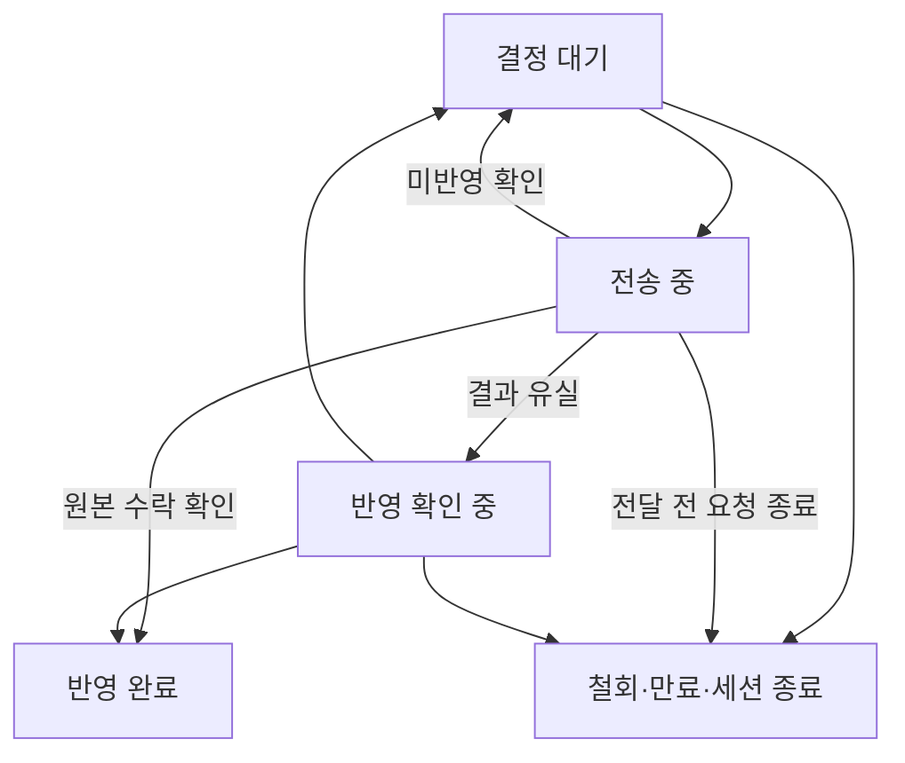

# AI 작업 상태·결정 대기 알림 설계

상태: **설계 초안 v0.2(PWA 결정 반영) · 0단계 검증 중** · 원본: 「맥미니 AI 작업 상태·결정 대기 알림 개발 명세」 초안 v0.1(2026-11-24, 비공개)

## 0. 이 문서가 원본과 다른 점

2026-11-24 사용자 결정: **갤럭시 네이티브 앱(Kotlin) 대신 PWA + Web Push로 MVP를 만든다.**

| 원본 | 이 문서 | 이유 |
|---|---|---|
| Kotlin·Compose 갤럭시 앱 | 기존 개인 비서 서비스(비공개)의 웹 UI에 화면을 추가하고 manifest·service worker로 PWA화 | 이 Mac에 Android SDK·adb가 없음. 기기 인증·Tailscale Serve HTTPS(`https://<맥 이름>.<tailnet>.ts.net`)를 그대로 재사용 |
| Firebase Cloud Messaging | **Web Push(VAPID, RFC 8030/8291/8292)**를 맥이 직접 발송 | Firebase 계정·`google-services.json` 불필요. 페이로드는 종단 간 암호화 |
| 알림창 상시 요약 카드(F03) | 요약은 **대시보드**가 기본. 요약 알림은 선택 기능(기본 끔) | 웹 알림은 상시(ongoing) 알림이 될 수 없고, Chrome은 푸시마다 알림 표시를 강제(userVisibleOnly)해 조용한 동기화가 안 됨 |
| 알림 채널 2개(F10) | 앱 안 설정으로 '요약 알림'·'결정 알림'을 나눔 | Android에서 사이트 알림은 채널 하나로 묶임 |
| F11 상태바 칩·Now Bar, F13 알림에서 답변 | **웹에서 불가 → 네이티브 전환 시 재검토** | Live Updates·인라인 답변은 네이티브 API |
| Claude Code·Codex 동시 MVP | **Claude Code 먼저**, Codex는 설치 후 3단계 | 이 Mac에 Codex CLI 없음 |

서버(맥미니 서비스)의 상태 모델·API·인수 조건은 원본을 유지한다. 나중에 네이티브 앱으로 옮겨도 서버는 그대로 쓴다.

## 1. 목표

맥미니에서 Claude Code(이후 Codex) 세션을 여러 개 실행해 두고, 갤럭시에서 **진행 중 작업 수**와 **내 답이 필요한 결정 요청**을 확인한다. 새 결정에만 배너와 진동이 온다. 알림을 누르면 질문과 선택지가 열리고, 답하면 원래 세션에 반영되어 작업이 이어진다.

- 결정 요청 = 작업 방향을 묻는 프로젝트 질문(예: "중복 발견 시 가져오기 전체 중단 / 해당 행만 건너뛰기"). 명령·파일 접근 같은 **실행 권한 요청**은 제공자 화면에서 처리하고, 이 앱은 세션 상세에 '권한 승인 대기'와 여는 경로만 보여 준다.
- 최상위 세션을 한 건으로 센다. 서브 에이전트는 상위 세션에 포함한다.

## 2. 기능

### 2.1 MVP

| ID | 기능 | 동작과 인수 조건 |
|---|---|---|
| F01 | 기기 연결 | 기존 기기 등록(QR·1회용 코드, `la_session` 쿠키, `/devices`)을 재사용한다. 등록된 기기가 PWA에서 알림을 허용하면 **푸시 구독**(endpoint·p256dh·auth)을 기기에 묶어 저장한다. `/devices`에서 기기를 해제하면 조회·응답·푸시 구독을 함께 지운다. |
| F02 | 세션 상태 수집 | 관리 세션의 시작·진행·입력 대기·완료·중단·실패를 수집한다. 식별자는 (제공자, 원본 세션 ID). 같은 세션의 턴을 여러 건으로 세지 않는다. 관리하지 않는 기존 세션은 검증된 관측 경로(훅)가 있을 때만 보조 모니터링한다. |
| F03 | 진행 요약 | 대시보드 상단에 '진행 3 · 결정 대기 2'. 연동이 정상인 유휴 상태는 '진행 0 · 결정 대기 0'. 선택 기능 '요약 알림'(기본 끔): 숫자가 바뀔 때 고정 tag 알림을 소리·진동 없이 교체한다. |
| F04 | 결정 요청 등록 | 제공자의 명시적 질문이나 구조화된 결정 요청만 접수한다. 원본 세션·요청 ID, 작업명, 질문, 선택지, 자유 입력 허용, 생성 시각, 선택적 마감을 저장한다. 일반 로그·턴 종료·대화 속 물음표·유휴는 상태에만 반영한다. 한 요청에 질문이 여러 개면 한 건으로 보여 주고 한 화면에서 모두 답한다. |
| F05 | 결정 푸시 | 요청이 처음 답변 가능해질 때 요청당 알림 한 건. 알림 문구는 **'AI 작업에 결정이 필요해요'** 같은 공통 문구만(작업명·질문·코드 미포함). 표시·소리는 기기 설정과 방해 금지를 따른다. |
| F06 | 목록·상세·마감 | 진행 중 세션과 열린 결정 목록. 결정은 마감 임박순, 같거나 마감 없는 것은 생성순. 상세에 작업명·제공자·질문·선택지·추천 이유·남은 시간 또는 '마감 없음'. 처리된 요청을 지난 알림으로 열면 결과를 보여 준다. |
| F07 | 원래 요청에 답변 | 선택지 또는 허용된 자유 입력 후 '보내기'. 갤럭시 키보드 음성 입력도 같은 흐름. 답은 해당 요청·원본 세션에 고정. '전송 중', '반영 완료', '재시도 가능한 실패', '반영 확인 중'을 구별한다. |
| F08 | 대기 해제·만료·재질문 | 원본 반영이 확인되면 목록과 알림을 정리한다. 맥에서 먼저 답한 요청도 확인 후 정리. 세션 종료·철회·마감 도달 시 새 응답을 닫고 사유를 표시. 추가 질문은 새 요청. |
| F09 | 연결 복구 | 연결이 끊기면 마지막 확인값과 시각을 '연결 끊김'/'갱신 지연'으로 표시. 앱 열기·새로고침·복구 시 서버 최신 상태로 맞춘다. 중복·지연 이벤트와 오래된 푸시가 화면을 과거로 되돌리지 않는다. |
| F10 | 알림 권한·설정 | 앱 안 설정에서 요약 알림·결정 알림을 따로 켠다. 알림 권한이 없어도 조회·답변 화면은 동작하고 권한 안내를 보여 준다. |

### 2.2 후속

| ID | 기능 | PWA에서 |
|---|---|---|
| F11 | 상태바 칩·Now Bar | 불가. 네이티브 전환 시 |
| F12 | '곧 올 것'(공개 예정 결정) | 가능 |
| F13 | 알림에서 바로 답변 | 불가(Chrome 알림에 텍스트 입력 없음). 선택지 버튼 액션은 검토 가능 |
| F14 | 구독 잔여 사용량 | 공식 경로가 있을 때만 |

### 2.3 상태와 숫자 계산

- **진행 수**: 작업 중인 최상위 세션 수. 창만 열려 있거나 다음 지시를 기다리는 세션은 유휴. 프로젝트 답변이나 권한 승인을 기다리며 전부 막힌 세션은 빠진다. 같은 세션에서 독립 작업이 도는 신호가 있으면 포함. 수집 못 한 세션이 있으면 마지막 확인값과 '갱신 지연'을 함께 표시.
- **결정 대기 수**: 처리가 확인되지 않은 열린 결정 요청 수. 한 세션의 서로 다른 요청 두 건은 두 건. 답을 보냈어도 반영 확인 전에는 남긴다. 반영 여부를 모르면 자동 재전송하지 않고 원본 상태를 조회한다.

| 요청 상태 | 대기 수 | 입력 | 진입 조건 |
|---|---|---|---|
| 공개 예정 | 아니요 | 아니요 | 후속(F12). 공개 시각 전 |
| 대기 | 예 | 예 | 최초 공개, 또는 미반영이 확인된 전송 실패 |
| 전송 중 | 예 | 아니요 | 서버가 답을 접수하고 입력권을 잠금 |
| 반영 확인 중 | 예 | 아니요 | 연결 단절·응답 유실로 반영 여부 불명 |
| 반영 완료 | 아니요 | 아니요 | 원본 수락 또는 다른 화면의 처리 완료 확인 |
| 철회·만료·세션 종료 | 아니요 | 아니요 | 철회·만료·세션 종료 확인 |

마감은 서버 UTC로 저장하고 폰에서 현지 시각·남은 시간으로 보여 준다. 서버 시각 ≥ 마감이면 새 응답을 받지 않는다. 접수했더라도 원본 전달 전에 마감·철회가 확인되면 전달을 중단한다.

## 3. 인수 테스트

조건 → 행동 → 검증. 도메인 계산·상태 전이는 고정 시계와 가짜 제공자로 자동화하고, 제공자 계약은 실제 CLI로, 알림 표시는 실제 갤럭시(S22 Ultra)에서 확인한다. 원본 T01~T37을 유지하되 PWA 때문에 바뀐 항목만 아래에 적는다(원본 테스트 전문은 이 저장소에 없음).

| ID | PWA 변경 |
|---|---|
| T01·T02 | 기존 기기 등록을 쓴다. T02의 '미전달 푸시 취소'는 '해당 기기 푸시 구독 삭제와 발송 대기열 취소' |
| T07 | 요약 알림을 켰을 때만 해당. 같은 tag 알림 하나가 소리·진동 없이 교체되고 최종 값 1 |
| T26 | 'PWA를 닫고 화면을 끈 상태'에서 모바일 데이터로 결정 발생 → 알림 도착, 누르면 잠금 해제 후 원래 상세 |
| T27 | 사이트 알림 권한 거부 시 팝업 없음, 앱 안 조회·답변 가능. 앱 안에서 요약만 끈 경우 결정 알림은 도착 |
| T28 | **완화**: 요약 알림을 닫아도 다음 숫자 변화 때 다시 나타날 수 있다(웹 제약). 닫은 뒤 다시 보지 않으려면 앱 안에서 요약 알림을 끈다 |
| T29 | `pushsubscriptionchange` 또는 구독 재발급 후 현재 구독만 사용, 410/404 응답 구독은 삭제, 중복 등록 없음 |
| T30 | 알림 문구·푸시 페이로드에 작업명·코드·답변 없음(페이로드는 이벤트 유형·불투명 요청 ID·스냅샷 버전만) |
| T31 | 1차는 Claude Code만. Codex는 3단계에서 추가 |
| T33·T34·T36 | 네이티브 전환 시까지 보류 |

MVP 완료 조건: T01~T32(위 변경 포함) 통과, T31 실환경 통과, 동시 응답·재전송 테스트에서 잘못된 세션 전달·중복 적용 0건. 측정 목표(원본 2.3절): 맥 이벤트 수신 → 상태 저장·발송 대기열 기록 p95 1초(세션 30개·이벤트 100개), 실제 갤럭시 Wi-Fi·모바일 데이터 각 10회 중 90%가 30초 안에 표시, 마지막 정상 갱신 2분 초과 시 '갱신 지연'.

## 4. 구성

| 구성 | 역할 | 선택 |
|---|---|---|
| 맥미니 서비스 | 세션·결정 상태 계산, 조회·응답 API, 푸시 발송 | 기존 Rust 서비스(axum·sqlx·SQLite). 같은 프로세스에 모듈로 붙일지 별도 바이너리로 둘지는 1단계에서 결정 |
| 제공자 연동 | 세션 이벤트를 공통 형식으로, 답을 원래 요청에 전달 | 0단계 결과로 결정(5장) |
| 폰 화면 | 대시보드·목록·상세·답변, 알림 클릭 처리 | PWA: manifest, service worker(`push`·`notificationclick`·`pushsubscriptionchange`), 기존 askama 화면 |
| 원격 접속 | 밖에서 상세 조회·답변 | Tailscale Serve HTTPS(tailnet only) + 기기 쿠키. 이미 운영 중 |
| 푸시 | 앱을 열지 않아도 새 결정 알림 | Web Push. VAPID 키는 설정 폴더에 600으로 보관. 맥 → 브라우저 푸시 서비스로 나가는 외부 연결이 필요 |

### 데이터와 API(원본 3.3 유지, 푸시 부분만 변경)

- 세션, 결정 요청, 답변 제출, 기기, 이벤트·알림 대기열: 원본 필드 그대로. 기기의 '푸시 토큰'은 **푸시 구독(endpoint·키)**으로 바뀐다.
- `POST /v1/pairing/exchange` → 기존 `/pair` 재사용.
- `GET /v1/snapshot`, `GET /v1/decisions/{id}`, `POST /v1/decisions/{id}/answers`(요청 버전 + 제출 ID, 멱등), `GET /v1/decisions/{id}/answers/{submissionId}`: 원본 그대로.
- `PUT /v1/device/push-token` → `PUT /v1/device/push-subscription`(인증된 현재 기기의 구독 교체), `DELETE` 동일 경로.
- 알림은 요약에 고정 tag, 결정에 요청별 tag를 써서 중복 푸시가 다시 울리지 않게 한다. 푸시 TTL은 마감보다 길지 않게.

## 5. 0단계: 핵심 연동 검증

목표: 폰에서 보낸 답이 원래 Claude Code 세션에 들어가 작업이 이어지는 경로를 확정한다.

| 후보 | 내용 | 확인할 것 |
|---|---|---|
| A. 관리 세션 + 권한 도구 | 서비스가 공식 `claude` CLI를 헤드리스로 띄우고, `AskUserQuestion` 호출을 권한 처리 경로로 가로채 답을 돌려준다 | 질문 구조 수신, 답 주입, 같은 세션 재개, 구독 로그인으로 동작 |
| B. 질문용 MCP 도구 | 우리 MCP 서버의 `ask_user` 도구를 세션에 붙이고, 도구 호출이 폰 답을 받을 때까지 기다린다 | 평소 대화형 세션에서도 동작하는지, 모델이 이 도구를 쓰게 할 수 있는지, 대기 시간 제한 |
| C. 훅 관측 | 평소 세션의 훅(UserPromptSubmit·Stop·Notification·SessionEnd 등)으로 진행·대기 상태만 수집 | 데스크톱 앱 Code 탭 세션에서도 훅이 오는지, 질문·권한 대기를 구별할 수 있는지 |
| D. 공식 Remote Control | Claude 공식 앱에서 세션을 원격으로 이어 받기 | 대체 경로로 쓸 수 있는 범위 |

**원칙**: 구독 로그인 토큰을 꺼내 API를 직접 부르지 않는다. 터미널에 문자열을 흘려 넣는 자동화를 쓰지 않는다. 직접 응답이 검증된 세션만 '보내기'를 켜고, 나머지는 공식 경로 링크를 보여 준다.

### 0단계 결과(2026-11-24, Claude Code 2.1.330)

실행 조건: 빈 임시 폴더, `CLAUDE_CODE_DISABLE_CLAUDE_MDS=1`, `--setting-sources project`, `--strict-mcp-config`, `--tools AskUserQuestion`. 로그인은 전용 설정 폴더 `CLAUDE_CONFIG_DIR=<전용 폴더>`(apiKeySource "none" = 구독). **기본 `~/.claude` 로그인은 만료 상태였다**(`OAuth session expired`).

| 후보 | 결과 | 근거 |
|---|---|---|
| A. 헤드리스 + `--permission-prompt-tool` | **통과** | MCP 도구가 `{tool_name:"AskUserQuestion", input:{questions[]}, tool_use_id}`를 받는다. `{"behavior":"allow","updatedInput":{...input,"answers":{"<질문 전문>":"<라벨>"}}}`를 텍스트로 돌려주면 도구 결과가 `"<질문>"="<라벨>"`로 들어가고 같은 세션에서 이어진다. 즉시 응답 7.4초, **98초 늦은 답도 정상 반영**(전체 103.8초) |
| A의 전제 | 확인 | 헤드리스에서 응답자(`--permission-prompt-tool` 또는 SDK 호스트)가 없으면 **AskUserQuestion이 도구 목록에서 빠진다**. 모델이 호출 흉내를 텍스트로 쓰고 끝남(haiku·sonnet 모두) |
| C. PreToolUse 훅으로 답 주입 | **통과(헤드리스)** | 훅이 `permissionDecision:"allow"` + `updatedInput.answers`를 내면 권한 도구는 불리지 않고 훅 답이 쓰인다. 훅 `timeout:600`에서 **75초 대기 후 답도 반영**, 기다리는 동안 `tool_progress` 이벤트가 나온다 |
| C. 관측 훅 | 부분 확인 | 헤드리스에서 SessionStart·UserPromptSubmit·PreToolUse·Stop·SessionEnd가 `session_id`·`cwd`와 함께 온다. Notification(`permission_prompt`·`idle_prompt`)은 대화형에서만 나와 아직 미확인. **데스크톱 앱 Code 탭 세션 확인은 사용자 전역 설정에 훅을 넣어야 해 승인 대기** |
| Agent SDK(TypeScript) | 쓰지 않음 | 문서상 인증은 API 키 권장, 구독 로그인 제공은 사전 승인 필요(외부 조사 설계와 같은 판단). 같은 기능을 공식 CLI의 A 경로로 얻음 |
| D. 공식 Remote Control | 대안으로 기록 | Claude Android 앱이 로컬 세션에 붙고, "Push when actions required"(권한·질문)·"Push when Claude decides" 푸시를 지원. Claude Code만 해당, 숫자 요약·Codex 통합·마감은 없음 |

**결론**

- **관리 세션은 A로 간다.** 서비스가 `claude -p --input-format stream-json --output-format stream-json --permission-prompt-tool mcp__<서비스>__approve`로 띄우고, 권한 도구가 결정 요청을 DB에 넣고 폰 답을 기다렸다가 돌려준다. 질문 외 도구의 권한 요청은 같은 도구로 들어오므로 '권한 승인 대기'로 표시하고 정책(허용 목록·거절)을 정한다.
- **평소 세션(데스크톱 앱 등)은 C로 관측**하고, 질문 답변까지 훅으로 할지는 실측 후 결정한다. 훅이 기다리는 동안 맥 화면에는 질문 카드가 뜨지 않으므로 **"맥과 폰 중 먼저 답한 쪽"(T15)을 만족할 수 없다** → '자리 비움' 모드에서만 폰으로 돌리는 식의 설계가 필요하다.
- 남은 0단계: 데스크톱 앱 세션에서 훅 이벤트 실측, 스트림 입력 모드에서 여러 턴·중단 확인.

### Web Push 실기 결과(2026-11-24, S22 Ultra)

시험 서버(`spikes/webpush/`): 외부 패키지 없이 Node 내장 crypto로 RFC 8291(aes128gcm)·RFC 8292(VAPID ES256)를 직접 구현. 수신 측 복호화를 따로 구현한 왕복 시험과 서명 검증 통과. Tailscale Serve 임시 포트 8443(tailnet 전용) → 127.0.0.1:8766.

| 항목 | 결과 |
|---|---|
| 구독 | Chrome 157에서 `fcm.googleapis.com` 엔드포인트로 구독 성공. Firebase 계정·설정 파일 없이 VAPID 키만으로 동작 |
| 발송 | 3회 모두 푸시 서비스 201 응답(요청 96~250ms) |
| 수신 지연 | 서비스 워커 `push` 수신까지 0.30·0.56·0.69초(맥·폰 시계 차이 포함). 30초 지연 발송(화면 끔 대기)도 0.69초 |
| 권한 | **Chromium은 알림 요청을 여러 번 거부·닫으면 사이트를 '자동으로 차단'하고 설정에서 허용을 고를 수 없게 한다** → 사이트 설정에서 '삭제 및 재설정'해야 풀림. PWA 화면은 권한 요청을 사용자가 누를 때만, 한 번만 띄우고 거부 시 해제 방법을 안내해야 함 |
| Brave | 처음 시도는 Brave였고 UA에 Brave 표시가 없어 Chrome과 구별되지 않음. 자동 차단에 걸려 검증 못 함. **지원 브라우저는 Chrome으로 고정** |
| 화면 표시(사용자 확인) | 화면 켜짐 배너, 잠금화면 표시, 소리·진동, 알림 탭 → 페이지 열림 모두 확인. 단 탭 시 서버로 보내는 기록(`notificationclick` ack)은 남지 않음 → 본 구현에서 클릭 처리 경로를 다시 확인 |
| 미확인(4단계로 미룸) | 모바일 데이터, Chrome 완전 종료 후 수신, 장시간 대기(Doze), 홈 화면 설치형, 10회 측정(2.3절) |

**결론**: PWA + Web Push로 결정 알림의 핵심 경로(구독 → 발송 → 잠금화면 표시 → 탭해서 열기)가 S22 Chrome에서 동작한다. 시험 포트 8443은 검증 후 닫음.

검증 스크립트는 이 저장소의 `spikes/claude-question/`(`ask_mcp.py`, `hook_ask.py`)에 있다. 1단계에서 서비스 코드로 다시 만든다.

## 6. 구현 순서

| 단계 | 내용 | 넘어갈 조건 |
|---|---|---|
| 0 | 연동 검증(5장), Web Push 실기 확인(S22 Ultra Chrome, 잠금화면·백그라운드) | 제공자 계약 확정, 실기 푸시 표시 확인 |
| 1 | 상태·API: SQLite 마이그레이션, 스냅샷, 요청·제출 상태 전이, 마감, 발송 대기열. 가짜 제공자로 검증 | T01~T09·T16~T20 서버 로직 자동 테스트 통과 |
| 2 | Claude Code 한 세션 왕복 + PWA 최소 화면·결정 푸시 | Wi-Fi에서 T08·T11·T13~T15·T21·T22·T31(Claude Code) |
| 3 | Codex 설치·연동, 동시 작업 라우팅, 재시작·부분 단절 | T03·T10·T13·T25·T32 |
| 4 | 모바일 데이터, 구독 갱신, 기기 해제, 잠자기·재부팅 복구, 측정 | T01~T32와 측정 목표 |
| 5 | 후속 기능(F12·F14), 필요하면 네이티브 앱 검토 | 포함한 기능의 테스트 |
